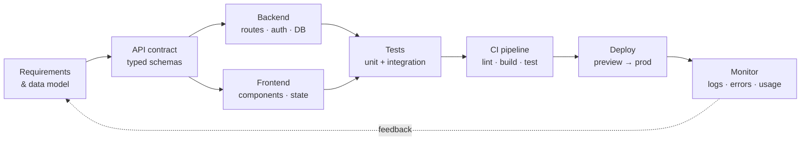
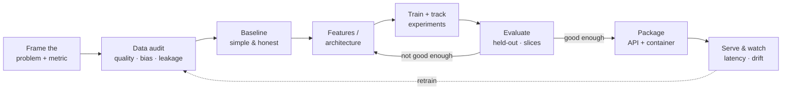

<!-- ╔══════════════════════════════════════════════════════════════════════════╗
     ║   HUZAIFA ARIF · Full Stack Developer & AI/ML Engineer                   ║
     ║   Animated GitHub profile README                                         ║
     ╚══════════════════════════════════════════════════════════════════════════╝ -->

<!-- ░░░░░░░░░░░░░░░░░░░░░░░ ANIMATED HEADER WAVE ░░░░░░░░░░░░░░░░░░░░░░░ -->

  

<!-- ░░░░░░░░░░░░░░░░░░░░░░░ TYPING ANIMATION ░░░░░░░░░░░░░░░░░░░░░░░ -->

  

<!-- ░░░░░░░░░░░░░░░░░░░░░░░ SOCIAL + VISITOR BADGES ░░░░░░░░░░░░░░░░░░░░░░░ -->

  
  
  

  
  

<!-- ░░░░░░░░░░░░░░░░░░░░░░░ ANIMATED DIVIDER ░░░░░░░░░░░░░░░░░░░░░░░ -->

  

<!-- Optional: an animated snake eating your contribution graph.
     Add the Platane/snk GitHub Action to this repo, then uncomment:

-->

 

<!-- ░░░░░░░░░░░░░░░░░░░░░░░ ABOUT ME ░░░░░░░░░░░░░░░░░░░░░░░ -->

##  &nbsp;About Me

I live in two worlds and enjoy the seam between them. On one side I build
**production web applications** — typed React frontends, REST/GraphQL APIs,
relational and document databases, auth, CI and deployment. On the other I build
**machine learning systems** — data pipelines, feature engineering, training
loops, evaluation harnesses, and inference services that respond in milliseconds.

The work I like most sits exactly in the middle: taking a model out of a notebook,
wrapping it in a clean API, putting a fast interface in front of it, and shipping
the whole thing so a non-technical person can use it without reading a README.

---

<!-- ░░░░░░░░░░░░░░░░░░░░░░░ WHAT I DO ░░░░░░░░░░░░░░░░░░░░░░░ -->

## 🧩 &nbsp;What I Do

<table>
  <tr>
    <td width="33%" valign="top" align="center">
       
      <h3>🌐 Full Stack Engineering</h3>
      

        Component-driven UIs with React &amp; Next.js. REST and GraphQL APIs on
        Node/Express and Flask/FastAPI. Schema design in PostgreSQL and MongoDB.
        Auth, caching, pagination, file uploads, background jobs — the unglamorous
        parts that decide whether an app survives real users.
      

    </td>
    <td width="33%" valign="top" align="center">
       
      <h3>🧠 AI / ML Engineering</h3>
      

        Computer vision (detection, segmentation, OCR), NLP (embeddings, RAG,
        classification) and classical ML on tabular data. I care about honest
        evaluation: proper splits, leakage checks, calibration, and metrics that
        match the business question rather than flatter the model.
      

    </td>
    <td width="33%" valign="top" align="center">
       
      <h3>🚀 Ship &amp; Operate</h3>
      

        Dockerized services, GitHub Actions pipelines, environment-driven config,
        logging and basic observability. Deploys to Vercel, Render and container
        hosts. Experiment tracking so a training run from last month can be
        reproduced this month.
      

    </td>
  </tr>
</table>

---

<!-- ░░░░░░░░░░░░░░░░░░░░░░░ TECH STACK ░░░░░░░░░░░░░░░░░░░░░░░ -->

## ⚡ &nbsp;Tech Arsenal

#### 🎨 &nbsp;Frontend

#### 🔧 &nbsp;Backend & APIs

#### 🗄️ &nbsp;Databases & Caching

#### 🤖 &nbsp;AI / ML & Data

  
  
  
  
  
  
  
  

#### ☁️ &nbsp;DevOps, Cloud & Tooling

---

<!-- ░░░░░░░░░░░░░░░░░░░░░░░ HOW I WORK ░░░░░░░░░░░░░░░░░░░░░░░ -->

## 🛠️ &nbsp;How I Work

  
<b>🌐 &nbsp;Building a web product — my default path</b>

   

**Non-negotiables:** the API contract comes before the UI, environment config never
lives in source, every merge runs through CI, and migrations are versioned.

  
<b>🧠 &nbsp;Building an ML system — my default path</b>

   

**Non-negotiables:** a dumb baseline before a deep model, a test set touched once,
slice metrics not just averages, and a fixed seed plus pinned versions so a result
can be reproduced.

  
<b>📐 &nbsp;Engineering principles I actually hold to</b>

   

| Principle | In practice |
| --- | --- |
| **Boring technology wins** | Proven tools for the core, experiments at the edges. |
| **Types are documentation** | TypeScript on the frontend, typed schemas at every boundary. |
| **Small reviewable commits** | Narrow diffs, meaningful messages, no "misc fixes". |
| **Measure, then optimize** | Profile first; a benchmark beats an opinion. |
| **Automate the repeat** | If I've done it three times by hand, it becomes a script. |
| **Write for the next reader** | Usually me, six months later, with no memory of this. |
| **Errors are a feature** | Clear messages, correct status codes, honest failure modes. |

  
<b>🤝 &nbsp;Working with me</b>

   

- **Communication:** short written updates, decisions recorded, no silent blockers.
- **Estimates:** ranges with assumptions stated, revised out loud when reality shifts.
- **Code review:** direct about the code, never about the person. I ask questions before I assert.
- **Handover:** a README that lets someone else run the project without asking me anything.

---

<!-- ░░░░░░░░░░░░░░░░░░░░░░░ GITHUB STATS ░░░░░░░░░░░░░░░░░░░░░░░ -->

## 📊 &nbsp;GitHub Analytics

  

  

<b>🔥 Contribution Heatmap</b>

  

  

---

<!-- ░░░░░░░░░░░░░░░░░░░░░░░ FOCUS AREAS ░░░░░░░░░░░░░░░░░░░░░░░ -->

## 🎯 &nbsp;Current Focus

| Area | What I'm pushing on | Status |
| :--- | :--- | :---: |
| 🧠 **Applied computer vision** | Prompt-driven detection & segmentation pipelines | 🟢 Active |
| 🔗 **LLM application engineering** | Retrieval, tool use, evaluation of generated output | 🟢 Active |
| ⚙️ **MLOps** | Reproducible training, model registries, drift monitoring | 🟡 Learning |
| 🏗️ **Scalable backends** | Queues, caching layers, horizontal scaling patterns | 🟡 Learning |
| 📘 **CS fundamentals** | Data structures & algorithms in C++, system design | 🔵 Ongoing |

  
  <b>&nbsp;Always one project behind on sleep, never on curiosity.&nbsp;</b>
  

---

<!-- ░░░░░░░░░░░░░░░░░░░░░░░ QUOTE ░░░░░░░░░░░░░░░░░░░░░░░ -->

### 💭 &nbsp;Dev Quote of the Day

---

<!-- ░░░░░░░░░░░░░░░░░░░░░░░ CONTACT ░░░░░░░░░░░░░░░░░░░░░░░ -->

## 🤝 &nbsp;Let's Build Something

I'm open to **full stack roles, AI/ML engineering work, freelance builds and
open-source collaboration** — especially anything that puts a model in front of
real users.

 

<!-- Add your public contact address here if you want one on the profile:

-->

  

<!-- ░░░░░░░░░░░░░░░░░░░░░░░ FOOTER WAVE ░░░░░░░░░░░░░░░░░░░░░░░ -->

  

  <i>⭐ If something here is useful to you, a star on a repo always makes the day better.</i>

